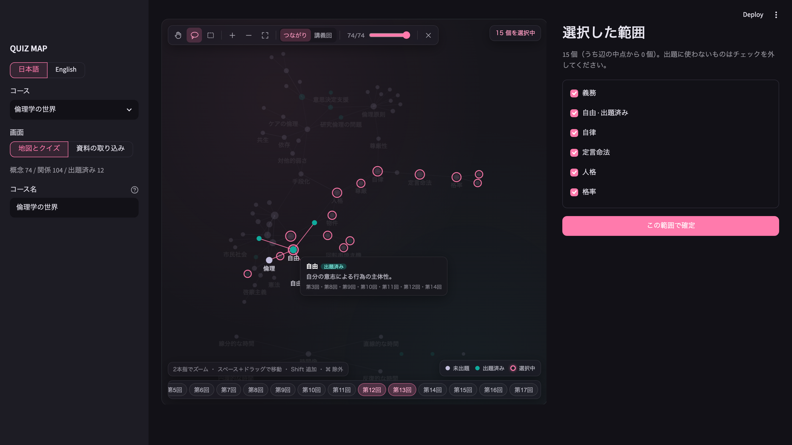

# QUIZ MAP — Lecture Quiz Maker

LNG302 Natural Language Processing 期末プロジェクト / 谷ちなみ
[English README](README.md)

**学期分の講義スライドから概念マップを作り、地図の一部を囲むと、囲んだ概念どうしの関係を問うクイズが出る学習ツールです。**

既存のクイズ生成ツールは、用語を 1 つずつ問います。しかし試験の前に私が実際に間違えるのは、考えどうしのつながりです（例: カントの「人格」と「尊厳」はどういう関係か）。QUIZ MAP は、そのつながりを学習の単位にします。LLM がスライドから種類つきの関係を取り出し、地図で授業のどの範囲を復習するかを選び、クイズはその範囲の中の関係を問います。



## できること

すべてアプリの中で完結します。

1. **アップロード**：講義の PDF を入れます。講義回はファイル名（「第3回」「week3」「Lecture 03」など）から読み取り、表で直せます。
2. **語彙の導出**（LLM）：スライドを読ませ、その授業で使う「概念の種類」と「関係の種類」を提案させます。関係の種類ごとに、定義と「クイズでの問い方」も書かせます。
3. **抽出**（LLM）：その語彙を固定して、概念を取り出し、次に概念どうしの関係を取り出します。どれにも講義回とページが付きます。
4. **地図**：概念を点、関係を線で描きます。配置は「つながり」（力学的配置）と「講義回」の 2 通りです。
5. **範囲の選択**：投げ縄か矩形で囲みます。Adobe のツールと同じく Shift で追加、⌘ で除外します。点のクリックと講義回ボタンでも選べます。
6. **クイズ**（LLM）：選んだ範囲の関係・具体例・定義を問う問題を作ります。誤答には地図上で隣り合う概念を使い、その後、各誤答が本当に誤りかをスライドに照らして確かめさせ、理由を言えないものは差し替えます。
7. **解答と採点**：4 択は自動で採点します。記述は LLM が 1 / 0.5 / 0 で採点し、何が足りないかを 1 行で返します。各問に解説と出典のスライドを出します。
8. **出題済みの概念は地図の色が変わります**。次のクイズで、まだ練習していない所を狙えます。

画面は日本語と英語を切り替えられます。

## 動かし方

必要なもの: Python 3.12、poppler（`pdftotext`, `pdftoppm`）、Google AI Studio の API キー（無料枠）

```
python3.12 -m venv .venv && .venv/bin/pip install -r requirements.txt
echo 'GEMINI_API_KEY=...' > .env
.venv/bin/streamlit run app.py
```

http://localhost:8501 を開き、「＋ 新しいコース」で PDF をアップロードして「取り込みを始める」を押します。

テスト（API を呼ばない）: `.venv/bin/pip install -r requirements-dev.txt && .venv/bin/playwright install chromium` の後、`.venv/bin/python -m pytest tests -q`

## LLM が判断している箇所

| 工程 | LLM が決めること | LLM が要る理由 |
|---|---|---|
| 語彙 | この授業に要る概念の種類と関係のラベル、各関係の問い方 | 適切なラベルは分野で違う（評価を参照）。固定すると分野が変わったとたんに壊れる |
| 抽出 | 概念、種類つきの関係、その出典ページ | キーワードではなく意味の構造を取り出す |
| 出題 | 問題文と 4 つの選択肢。各関係の question_style に沿う | — |
| 誤答の自己確認 | 各誤答がスライドに照らして本当に誤りか | 「誤答が実は正解」という事故を防ぐ |
| 記述の採点 | 1 / 0.5 / 0 とコメント（LLM-as-judge） | 自由記述の答え |
| 関係の補完（RAG） | スライドでつながっていない 2 つの概念に関係があるか。根拠はスライドか Wikipedia の引用 | スライドは考えの間の説明を端折ることが多い |
| 答えの検証（RAG） | 答えがスライドから導けるか、ほかの選択肢が一般的な知識では正解になってしまわないか | スライドの範囲では答えが 1 つでも、実際には 2 つになる問題を防ぐ |

LLM を使っていないのは、地図の描画と範囲の選択だけです。

## 設計上の判断

**語彙を固定せず、資料から導出する。** 最初の試作では、倫理学の授業に合わせた関係ラベルを決め打ちしていました。別の資料に当てると、関係を合わないラベルに黙って押し込みました。今は授業ごとにラベルを提案させ、`vocab.json` に保存します。保存した語彙は固定し、取り込み直しでも使い回すので、結果を数えて比べられます。「その他」に落ちた関係の割合が、語彙が資料に合っていないことを知らせる信号になります。

**抽出は 2 段階。** まず回ごとに概念を取り出します。そのとき既出の概念の一覧を渡し、回をまたいで名前を揃えさせます。次に関係を取り出し、両端には 1 段階目の概念 id しか使わせません。両方を一度に取り出させると、存在しない概念を指す関係が出ました。

**概念と関係は必ずページを持つ。** ヒント、解説、採点後に見せるスライドがこれに依存します。

**何よりも先にテキストを正規化する。** PDF からテキストを取り出すと、常用漢字が部首の別の文字コードになっていました（人 → ⼈、民 → ⺠）。NFKC は康熙部首は直しますが、CJK 部首補助（U+2E80 台）は直さないので、手動の対応表も当てます。そのうえで語の途中の改行を取り除きます。これをしないと検索や照合が黙って失敗します。

**問い方をコードに書かない。** コードは問題の問い方を一切持ちません。関係ラベルごとに、語彙の導出のときにモデルが書いた question_style があり、出題のプロンプトはそれに従います。授業が変われば、問い方も自動で変わります。

**誤答は隣の概念から作り、自己確認する。** 地図上で隣り合う概念は、もっともらしい誤答になります。もう 1 回呼び出して、各誤答がなぜ誤りかをスライドに基づいて 1 行で述べさせ、述べられないものを差し替えます。

**ヒントは答えを言わない。** 最初の版は概念の定義をヒントに出していましたが、定義を問う問題ではそれが答えそのものでした。今は出典のスライドを見せる形にして、資料を探す作業を学習者に残しています。

**語彙は、関係の両端に来てよい種類も決める。** 例えば「提唱」は人物から考えへの関係です。抽出の後にコードですべての関係をこれと照らし、合わないものは「その他」に付け替えます。評価では、この照合だけで、30 本中の誤りが 9 本から 2 本に減りました。

**出典の本は概念にしない。** スライドには出典の書名が載っていて、モデルはそれを概念にしてしまいました。「しないように」と指示しても効きませんでした。そこで語彙の側で、出典の文献をまとめた種類に印（`cited_work`）を付けさせ、その種類の概念を、関係を取り出す前にコードで落とします。落とした書名は記録します。

**出力は資料の言語に合わせる。** スライドが日本語か英語かを判定し、語彙・概念・問題・解説をその言語で書かせます。画面の言語は別の設定です。

**検索（RAG）は関係と答えの確認に使い、地図に単語を足さない。** 方針は利用者が決めました。地図の概念はすべてアップロードした資料に載っているもの、外部の資料は概念どうしの関係の確認と、問題の答えが一つに決まるかの確認にだけ使う、答えは必ずアップロードした資料から導ける、の 3 つです。取り込みのときに全スライドのページを埋め込み（`gemini-embedding-001`）、コースごとの索引を作ります。次に補完の工程で、どの関係にもつながらない概念と、同じスライドに出てくるのに関係の無い概念の対を調べます。対ごとに関連するスライドのページと、両方の概念の Wikipedia の冒頭を取り出し、授業の語彙のラベルで関係が成り立つかをモデルに判定させます。スライドの引用で裏付けられた関係は普通の関係として、Wikipedia だけで裏付けられた関係は「外部資料で補った関係」として足し、地図では出典つきの点線で描きます。外部資料で補った関係は、出題の材料には使いません。問題を作った後には検証の工程があり、正答と各選択肢についてスライドのページと Wikipedia の冒頭を取り出し、正答がスライドにたどれない問題を外し、ほかにも正解になる選択肢を差し替えるか問題を外します。検索と判断はすべて記録するので、検索の誤りと生成の誤りを分けて数えられます。設計は `docs/rag-design.md` にあります。

**表示の数と抽出の深さは別。** 地図に出す点の数は減らせますが、抽出したデータは消しません。そもそも何個の概念を取り出すかは抽出のときに決まり、モデルと呼び出し回数に依存します（既知の課題を参照）。

**地図の部品。** 最初の地図は Plotly でした。Streamlit は図が変わるたびに Plotly の選択を消すので、投げ縄の選択、講義回ボタンの選択、拡大の状態を保つために、ブラウザ側の回避策を何層も重ねることになり、何度も壊れました。今の地図は小さな canvas の部品（Streamlit components v2）で、表示と選択をブラウザ側で持ち、選択だけを Python に返します。

## モデルと費用

**開発**: Claude Code（ハーネス）＋ Claude Fable 5.1 と Claude Opus 5.5（モデル）。開発は Claude Code のセッションのチームで行いました。指揮役 1 つと 5 つの役割（UI 評価、UI 改善、出力評価、プロンプト改善、機能開発）が、それぞれ別の git の作業ツリーと端末で動き、GitHub の Issue とプルリクエストでやりとりしました。評価する役は直さず、直す役は自分の修正を評価しません。`CLAUDE.md` と `.claude/agents/` を参照してください。

**アプリの中**: Google AI Studio の無料枠で、生成に `gemini-3.1-flash-lite`、検索の索引に `gemini-embedding-001`。やっているのは構造化された抽出で、難しい推論ではないので、授業の原則どおり「仕事をこなせる最も安いモデル」を選びました。選ぶ前に API で使えるモデルの一覧を取得しました。無料枠で最安の `gemini-2.5-flash-lite` は新規の利用者には提供されなくなっていたので、次に安いものを使っています。モデル名は設定（`QUIZMAP_MODEL`）で切り替えられ、ほかのモデルと比べられます。呼び出しはすべて JSON スキーマ指定の構造化出力で、呼び出しの間に待機を入れ、HTTP 429 では指数バックオフで再試行します。

| 操作 | API 呼び出し | 時間 |
|---|---|---|
| 17 回 185 ページの取り込み（倫理学） | 35 | 約 4 分 |
| 4 回 136 ページの取り込み（NLP、英語） | 9 | 88 秒 |
| 5 問の生成 | 2 | 約 11 秒 |
| 採点（4 択のみ / 記述あり） | 0 / 1 | — |

## 評価

<!-- EVAL:BEGIN（data/team/output-reviewer/summary-for-readme.md から差し込み） -->
数字はすべて件数と分母で示す。「修正前」はコミット `fb02246` のプロンプトで、語彙と graph は 2026-10-19 に `gemini-3.1-flash-lite` で作ったもの。手順は `eval-protocol.md` にあり、乱数の種を 20261024 に固定しているので、同じ標本で測り直せる。語彙と抽出の「修正後」は、最終コードで倫理学を 3 回作り直したもの（§1）。問題の質・採点・地図の価値は、修正前の graph に修正後の出題・採点のコードを当てて測ったので、変化は出題と採点の修正だけによる。

#### 1. 語彙の質（§12-1・§12-2）

評価の最後の main（最終コード）で、倫理学の全 17 回を 3 回作り直した。`gemini-3.1-flash-lite` で 2 回、`gemini-3.8-flash` で 1 回。モデル以外の条件は 3 回とも同じ。作り直すたびに語彙も導き直すので、ラベルと種類は回ごとに違う。

|  | 修正前（fb02246） | flash-lite 1 回目 | flash-lite 2 回目 | gemini-3.8-flash（途中で停止） |
|---|---|---|---|---|
| 概念の種類（落とす本の種類を除く） | 6 | 3 | 3 | 4 |
| 関係ラベル（＋その他） | 6 | 6 | 6 | 8 |
| 概念 / 関係 | 74 / 104 | 82 / 54 | 77 / 48 | 第13回までで 176（概念の抽出だけ。本を落とす前。関係は無い） |
| 関係の「その他」 | 32 / 104 (30.8%) | 20 / 54 (37.0%) | 15 / 48 (31.2%) | – |
| 種類が「その他」の概念 | 28 / 74 | 1 / 82 | 0 / 77 | – |
| 人物の概念 | 0 | 23 | 24 | – |
| 本の概念（関係の抽出の前に落とす） | 0 | 0（39 件を落とした） | 0（21 件を落とした） | – |
| 出題に使える関係（その他以外） | 72 | 34 | 33 | – |
| 人物を含まない関係 | 104 | 18 | 8 | – |
| 両端の種類が語彙の指定に合わない関係 | – | 0 / 34 | 0 / 33 | – |
| どの関係にもつながらない概念 | 3 / 74 | 24 / 82 | 19 / 77 | – |
| 修正前の概念のうち無いもの | – | 34 / 74 | 37 / 74 | – |

**モデルの選び方。** `gemini-3.8-flash` は第13回で止まった。無料枠ではこのモデルは 1 日 20 回までで、1 つの授業には約 35 回要る。第13回までに概念 176 を取り出した。flash-lite は 2 回とも、同じ時点で約 112（本を落とす前の数）。語彙は種類 5（本の種類を除くと 4）・ラベル 8（＋その他）で、「下位区分」（部分と全体）と「対比」（対立）が両方そろい、学説・立場の種類が人物と分かれたのはこの回だけ。1 回の呼び出しのトークンは約 16,000（思考トークンが出力の約 1.8 倍）で、flash-lite は約 7,100（思考なし）。成功 14 回に 3,000 秒かかった（429・503 の待ちを含む）。flash-lite は 35 回で 230〜290 秒。網羅性はモデルで大きく変わるが、無料枠で 1 つの授業を 1 日で取り込めるのは flash-lite だけ。

| | 倫理学 修正前 | NLP 修正前（4 回、英語のスライド） |
|---|---|---|
| 関係ラベル | 提唱・対立・手段・目的・根拠・変容・包含 | 依存・構成・目的・包含・変換・尺度・対立 |
| 関係の「その他」 | 32 / 104（30.8%） | 3 / 26（11.5%） |

導き出された語彙は分野ごとに違い、両方に出たのは 対立 と 包含 だけ。最終コードで英語のスライド（NLP 第1回）を入れると、語彙・概念・問題が英語で出た（日本語が混じった概念 0 / 27、問題 0 / 5）。

#### 2. 抽出の正しさ（§12-6、無作為に選んだ関係 30 本）

各回の graph から、種 20261024 で関係を 30 本選んで判定した。3.8-flash の回は関係が無い。

|  | 修正前（fb02246） | flash-lite 1 回目 | flash-lite 2 回目 | gemini-3.8-flash（途中で停止） |
|---|---|---|---|---|
| 正しい | 6 / 30 | 17 / 30 | 25 / 30 | – |
| 曖昧 | 16 / 30 | 9 / 30 | 3 / 30 | – |
| 誤り | 8 / 30 | 4 / 30 | 2 / 30 | – |
| ラベルが食い違う概念対 | 10 | 0 | 0 | – |
| 両端の概念名が出典ページにある関係（人名は姓でも照合） | 67 / 104 | 39 / 54 | 39 / 48 | – |

**作り直すたびの揺れ。** flash-lite の 2 回は同じコード・同じモデルなのに、大きく違った。「その他」は 20 / 54 と 15 / 48、人物を含まない関係は 18 本と 8 本、30 本の判定（正しい / 曖昧 / 誤り）は 17 / 9 / 4 と 25 / 3 / 2。2 回目は、出題に使える関係 33 本のうち 30 本が 提唱（人物 → 概念）で、関係の問題はほとんど「誰が提唱したか」になる。版どうしのこの程度の差を、修正の効果と読んではいけない。作り直すたびに語彙を導き直すので、ラベル・種類に加えて、ラベルの両端に来てよい種類の狭さも変わる。両端の種類が狭く作られると、意味の上ではラベルが合う関係も「その他」になる（#74）。これが「その他」率の揺れの大きな元の 1 つ。

#### 3. 問題の質（§12-3、6 つの講義回の範囲で 30 問）

「修正後」は、修正した出題のコード（`97635f3`）を「修正前」と同じ古い graph に当てたもの。変化は出題の修正だけによる。

| | 修正前 | 修正後 |
|---|---|---|
| 使える | 15 / 30 | 20 / 30 |
| 直せば使える | 5 / 30 | 8 / 30 |
| 使えない | 10 / 30 | 2 / 30 |
| 正答が誤り | 9 / 30 | 1 / 30 |
| 誤答が実は正しい（4 択） | 6 / 24 | 1 / 24 |
| 正答の添字が別の選択肢を指す | 4 / 24 | 0 / 24 |
| 関係の向きを逆にして出題 | 4 / 30 | 1 / 30 |
| 使えない問題（関係 / 具体例 / 定義） | 6/12・4/12・0/6 | 1/12・1/7・0/11 |
| 記述の採点が期待どおり（6 問 × 5 解答、2 回採点） | 25 / 30（甘い 0、厳しい 3、揺れ 2） | 29 / 30（甘い 0、厳しい 1、揺れ 0） |

#### 4. 選択と出題の一致・地図の価値（§12-4・§12-5）

| | 修正前 | 修正後 |
|---|---|---|
| 範囲外の概念を使った問題 | 0 / 30 | 0 / 30 |
| どれかの問題に出た範囲の概念 | 35 / 80 | 38 / 80 |
| 別の範囲にほぼ同じ問題が出た組 | 5 | 2 |

| 同じ 8 概念の範囲・各 5 組 | 地図で囲む | 無作為 |
|---|---|---|
| 範囲内の関係 | 29 | 3 |
| 孤立した概念 | 0 / 40 | 30 / 40 |
| 最大のつながり（平均） | 8.0 | 1.8 |

地図で囲むと、範囲内の関係が約 10 倍になる。範囲内の関係は、関係を問う問題の材料になる。2 種類の範囲から作った問題そのものの比較はまだで、API が要る。
<!-- EVAL:END -->

## 既知の課題

- **作り直すたびの揺れ。** 抽出は取り込み 1 回につき 1 度だけ走り、導き出される語彙も作り直すたびに変わります（倫理学のある回では「対立」が出て、次の回では代わりに「言い換え」が出た）。評価の数字は 1 回ずつの結果です。揺れの大きさは評価の節を参照してください。
- **概念どうしの関係が少ない。** 最も安いモデルでは、関係の多くが人物から考えへのものになります。関係を問う問題の材料として一番良い「考えどうしの関係」は、倫理学で 20〜30 本程度にとどまります。プロンプトで促しても増えませんでした（Issue #51）。上位のモデルとの比較は評価の節にあります。
- **出典の本を落とすと、同じ名前の考えも消えることがある。** 「社会契約」や「自由からの逃走」が書名としてだけ取り出され、本と一緒に落ちました（Issue #69）。落とした書名は記録されるので、確かめられます。
- **スライドの再掲。** 後の回が前の回のスライドを再掲することがあり、登場回数が水増しされます。

## リポジトリの構成

| 場所 | 中身 |
|---|---|
| `app.py` | 入口。コースと画面の切り替え |
| `ui/` | 画面（`map_view.py`, `quiz_view.py`, `ingest_view.py`）、地図の部品（`static/map.js`, `map.css`）、画面の文言（`i18n.py`） |
| `quizmap/` | PDF のテキスト、LLM 呼び出し（`common.py`）、語彙（`vocab.py`）、抽出（`extraction.py`）、出題（`quiz.py`）、採点（`grade.py`）、コースと裏での取り込み（`courses.py`） |
| `tests/` | 単体テストと、ブラウザで操作するテスト（Playwright） |
| `quiz-map-spec.md` | 仕様書 |
| `derive_vocab.py`, `extract.py`, `generate_quiz.py` | 同じ工程のコマンド版 |
