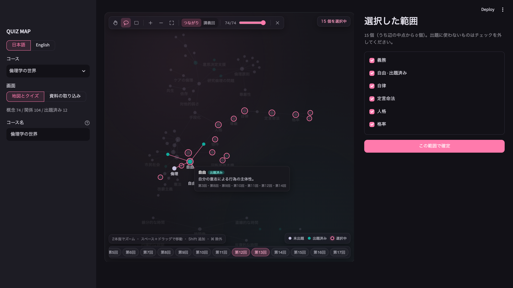

# QUIZ MAP — Lecture Quiz Maker

LNG302 Natural Language Processing, term project. Chinami Tani.
[日本語版 README](README.ja.md)

**QUIZ MAP turns a semester of lecture slides into a concept map. Lasso part of the map, and it writes a quiz about how the concepts you circled relate to each other.**

Existing quiz generators ask about one term at a time. What I actually get wrong before an exam is the link between ideas ("how does Kant's *person* relate to *dignity*?"). QUIZ MAP makes those links the unit of study: an LLM extracts typed relations from the slides, the map lets me choose a region of the course, and the quiz asks about the relations inside it.



## What it does

Everything happens inside the app.

1. **Upload** the lecture PDFs. Lecture numbers are read from file names (`第3回`, `week3`, `Lecture 03` …) and can be corrected in a table.
2. **Vocabulary derivation** (LLM). The model reads the slides and proposes the *kinds of concepts* and the *kinds of relations* that this particular course uses, each relation with a definition and a *question style*.
3. **Extraction** (LLM). Using that fixed vocabulary, the model extracts concepts, then relations between them, each with the lecture and page it came from.
4. **Map.** Concepts are dots, relations are lines. Two layouts: by links (force-directed) and by lecture.
5. **Select a region** with the lasso or marquee (Shift adds, ⌘ subtracts, as in Adobe tools), by clicking dots, or with the lecture buttons.
6. **Quiz** (LLM). Questions about relations, examples and definitions in the selected region. Distractors come from neighbouring concepts on the map, then the model checks each distractor against the slides and replaces any it cannot justify as wrong.
7. **Answer and grade.** Multiple choice is graded automatically; short answers are graded by the LLM (1 / 0.5 / 0) with a one-line note on what is missing. Each question shows its explanation and the source slide.
8. **Asked concepts change colour** on the map, so the next quiz can target what you have not practised.

The interface is available in Japanese and English.

## How to run

Requirements: Python 3.12, poppler (`pdftotext`, `pdftoppm`), a Google AI Studio API key (free tier).

```
python3.12 -m venv .venv && .venv/bin/pip install -r requirements.txt
echo 'GEMINI_API_KEY=...' > .env
.venv/bin/streamlit run app.py
```

Open http://localhost:8501, choose “+ New course”, upload PDFs, and press “Start import”.

Tests (no API calls): `.venv/bin/pip install -r requirements-dev.txt && .venv/bin/playwright install chromium`, then `.venv/bin/python -m pytest tests -q`.

## Where the LLM is used

| Step | What the LLM decides | Why it needs an LLM |
|---|---|---|
| Vocabulary | Which concept kinds and relation labels this course needs, and how to ask about each relation | The right labels differ by field (see Evaluation); fixed labels break when the subject changes |
| Extraction | Concepts, typed relations, and their source pages | Semantic structure, not keywords |
| Question writing | Question text and four choices, following each relation's `question_style` | — |
| Distractor self-check | Whether each wrong choice is really wrong according to the slides | Prevents “distractor that is actually correct” |
| Short-answer grading | 1 / 0.5 / 0 with feedback (LLM-as-judge) | Free-text answers |

Only the map drawing and the selection are plain code.

## Design decisions

**Derive the vocabulary instead of fixing it.** A first prototype used fixed relation labels written for an ethics course. Applied to other material it silently forced relations into wrong labels. The app now asks the model to propose the labels for each course and stores them in `vocab.json`. The vocabulary is then frozen and reused on every re-import, so results can be counted and compared. The share of relations that fall into “other” is the signal that the vocabulary does not fit the material.

**Two-stage extraction.** Concepts are extracted first, lecture by lecture, with the list of concepts already found passed in so names stay consistent across lectures. Relations are extracted second, and the model may only use the concept ids from stage one. Extracting both at once produced edges pointing at concepts that did not exist.

**Every concept and relation keeps its page.** Hints, explanations and the slide shown after grading all depend on it.

**Text normalisation before anything else.** PDF text extraction returned CJK radicals instead of ordinary kanji (人 → ⼈, 民 → ⺠). NFKC fixes the Kangxi block but not the CJK Radicals Supplement, so a manual table is applied as well, then line breaks inside words are removed. Without this, search and matching silently fail.

**Questions are not templated.** The code never says how to ask a question. Each relation label carries its own `question_style`, written by the model during vocabulary derivation, and the quiz prompt follows it. A different course gets different question styles automatically.

**Distractors from neighbours, then a self-check.** Neighbouring concepts on the map make plausible wrong answers. A second call asks for a one-line, slide-based reason why each distractor is wrong and replaces the ones that have none.

**Hints do not reveal answers.** The first version showed the concept's definition as a hint, which *is* the answer to a definition question. The hint now reveals the source slide, which keeps the retrieval step with the learner.

**The vocabulary also says which kinds may sit at each end of a relation.** “Proposes” runs from a person to an idea, for example. After extraction, code checks every relation against this and relabels the ones that do not fit as “Other”. In the evaluation this single check cut wrong relations from 9 to 2 out of 30.

**Cited books are not concepts.** Slides list their sources, and the model kept turning those titles into concepts. Telling it not to did not work. Instead, the vocabulary marks which concept kind holds cited works (`cited_work`), and code removes those concepts before relations are extracted. The removed titles are logged.

**Output follows the language of the material.** The app detects whether the slides are Japanese or English and asks the model to write the vocabulary, concepts, questions and explanations in that language. The interface language is a separate setting.

**Display density is not extraction depth.** The map can show fewer dots, but it never deletes extracted data. How many concepts are extracted at all is decided at extraction time and depends on the model and the number of calls (see Known limitations).

**Map component.** The first map used Plotly. Streamlit resets a Plotly chart's selection whenever the figure changes, so keeping a lasso selection, lecture-button selection and the current zoom alive required layers of browser-side workarounds that broke repeatedly. The map is now a small canvas component (Streamlit components v2) that keeps its view and selection in the browser and only reports the selection back to Python.

## Models and cost

**Development:** Claude Code (harness) with Claude Fable 5.1 and Claude Opus 5.5 (models). Development ran as a team of Claude Code sessions: one coordinator and five roles (UI reviewer, UI improver, output reviewer, prompt improver, feature developer), each in its own git worktree and terminal, coordinated through GitHub issues and pull requests. Reviewers never fix and fixers never judge their own fixes. See `CLAUDE.md` and `.claude/agents/`.

**Inside the app:** `gemini-3.1-flash-lite` through the Google AI Studio free tier. The work is structured extraction, not hard reasoning, so the cheapest model that does the job was chosen, following the course principle. I listed the available models with the API before choosing: the cheapest free-tier model, `gemini-2.5-flash-lite`, is no longer offered to new users, so the next cheapest was used. The model name is a setting (`QUIZMAP_MODEL`) so other models can be compared. All calls use JSON-schema structured output, wait between calls, and back off on HTTP 429.

| Operation | API calls | Time |
|---|---|---|
| Import 17 lectures / 185 pages (ethics) | 35 | about 4 min |
| Import 4 lectures / 136 pages (NLP, English) | 9 | 88 s |
| Generate 5 questions | 2 | about 11 s |
| Grade (multiple choice only / with short answers) | 0 / 1 | — |

## Evaluation

<!-- EVAL:BEGIN（data/team/output-reviewer/summary-for-readme.md から差し込み） -->
All numbers are counts with denominators. Model: `gemini-3.1-flash-lite`. "Before" = prompts at commit `fb02246` (vocab/graph generated 2026-10-19). The evaluation protocol is in `eval-protocol.md` (fixed random seed 20261024, so the samples are reproducible). "After" for vocabulary and extraction = the fixes for #8–#12 (regenerated 2026-10-24) plus the kind check of #49. The kind check was applied afterwards to the regenerated graph, so the numbers may change slightly when everything is regenerated with the final code. The After sample is a new random 30 from the regenerated graph. Each version was extracted only once; run-to-run variation was not measured.

#### 1. Vocabulary quality (§12-1, §12-2)

| | Ethics before (17 lectures, 185 pages) | NLP before (4 lectures, 136 pages, English slides) | Ethics after |
|---|---|---|---|
| Concept kinds | 6 | 5 | 5 |
| Relation labels | 6 + Other | 7 + Other | 6 + Other |
| Concepts / relations extracted | 74 / 104 | 13 / 26 | 129 / 79 |
| Relations labelled "Other" | 32 / 104 (30.8%) | 3 / 26 (11.5%) | 49 / 79 (62%); 14 / 44 (32%) without book relations |
| Concepts with kind "Other" | 28 / 74 (37.8%) | 5 / 13 (38.5%) | 0 / 129 |
| Label with 0 relations | Proposes | Opposes | none |
| Person concepts | 0 | – | 30 |
| Relations whose end kinds break the vocabulary | – | – | 0 / 30 |
| Relations usable for questions (not "Other") | 72 | – | 30 |
| Concept–concept relations (no person, no book) | 104 | – | 25 |

The derived vocabulary differs by field. Ethics got *proposes, opposes, means–end, grounds, transformation, inclusion*. NLP got *depends on, composed of, purpose, inclusion, conversion, metric, opposes*. Only *opposes* and *inclusion* appear in both.

The same defect showed up in both courses: a relation label has no concept kind that can fill its subject or object slot. For example, there is no "person" kind for *proposes* and no "metric" kind for *metric*. As a result, Ethics has 0 person concepts, although Kant appears in 10 lectures.

After the fix, the vocabulary has a person kind (30 person concepts), and no concept falls into "Other". Each relation label now states which kinds may appear at each end, and relations that break this are relabelled "Other". Most of the "Other" relations are author → book. Without them, the "Other" rate (32%) is about the same as before.

Two problems remain. Books still become concepts (36 of 129). Concept–concept relations fell from 104 to 25, so relation questions have less material.

With English slides (NLP lecture 1), the vocabulary, concepts and questions came out in English: 0 of 27 concepts and 0 of 5 questions contain Japanese. Only the fixed label "その他" (Other) stays in Japanese.

#### 2. Extraction accuracy (§12-6, 30 random relations)

| | Before | After |
|---|---|---|
| Correct | 6 / 30 | 22 / 30 |
| Ambiguous | 16 / 30 | 6 / 30 |
| Wrong | 8 / 30 | 2 / 30 |
| Correct / ambiguous / wrong, book relations excluded | 6 / 16 / 8 (no books) | 10 / 5 / 2 (17 relations) |
| Concept pairs with conflicting labels | 10 pairs | 0 pairs |
| Relations whose cited page contains both concept names | 67 / 104 | 52 / 79 (69 / 79 when person names are matched by surname) |

#### 3. Question quality (§12-3, 30 questions over 6 lecture ranges)

"After" uses the fixed question-generation code (`97635f3`) on the *same old* graph as "Before", so the change comes from the question-generation fixes only.

| | Before | After |
|---|---|---|
| Usable | 15 / 30 | 20 / 30 |
| Usable after a fix | 5 / 30 | 8 / 30 |
| Not usable | 10 / 30 | 2 / 30 |
| Correct answer wrong | 9 / 30 | 1 / 30 |
| A distractor is actually correct (MCQ) | 6 / 24 | 1 / 24 |
| Answer index points to the wrong choice | 4 / 24 | 0 / 24 |
| Relation asked in the reverse direction | 4 / 30 | 1 / 30 |
| Not usable, by aspect: relation / example / definition | 6/12 · 4/12 · 0/6 | 1/12 · 1/7 · 0/11 |
| Short-answer grading matches the expected score (6 questions × 5 answers, graded twice) | 25 / 30 (too lenient 0, too strict 3, unstable 2) | 29 / 30 (too lenient 0, too strict 1, unstable 0) |

#### 4. Selection and map value (§12-4, §12-5)

| | Before | After |
|---|---|---|
| Questions using a concept outside the selection | 0 / 30 | 0 / 30 |
| Selected concepts covered by at least one question | 35 / 80 | 38 / 80 |
| Near-duplicate question pairs across ranges | 5 | 2 |

| Same size (8 concepts), 5 ranges each | Lasso on the map | Random |
|---|---|---|
| Relations inside the range | 29 | 3 |
| Isolated concepts | 0 / 40 | 30 / 40 |
| Largest connected group (mean) | 8.0 | 1.8 |

Selecting by lasso gives about 10 times more relations inside the range, and those relations are the material for relation questions. We have not yet compared questions generated from the two kinds of range. That comparison needs API calls.
<!-- EVAL:END -->

## Known limitations

- **Run-to-run variation.** Extraction runs once per import, and the derived vocabulary changes between runs (one ethics run had *opposes*, the next had *paraphrase* instead). The numbers in the evaluation are single runs; see the evaluation for the size of the variation.
- **Few concept-to-concept relations.** With the cheapest model, most relations connect a person to an idea. Relations between ideas, which are the best material for relation questions, stay at about 20–30 for the ethics course. Prompting for them did not help (issue #51). A stronger model is compared in the evaluation.
- **Removing cited books can remove ideas with the same name.** *Social Contract* or *Escape from Freedom* were extracted only as book titles and were removed with them (issue #69). The removed titles are logged so this can be checked.
- **Repeated slides.** Later lectures sometimes repeat earlier slides, which inflates occurrence counts.

## Repository layout

| Path | Contents |
|---|---|
| `app.py` | Entry point: course and view switching |
| `ui/` | Screens (`map_view.py`, `quiz_view.py`, `ingest_view.py`), the map component (`static/map.js`, `map.css`), UI strings (`i18n.py`) |
| `quizmap/` | PDF text, LLM calls (`common.py`), vocabulary (`vocab.py`), extraction (`extraction.py`), quiz (`quiz.py`), grading (`grade.py`), courses and background import (`courses.py`) |
| `tests/` | Unit tests and browser tests (Playwright) |
| `quiz-map-spec.md` | Specification (Japanese) |
| `derive_vocab.py`, `extract.py`, `generate_quiz.py` | Command-line versions of the same steps |
